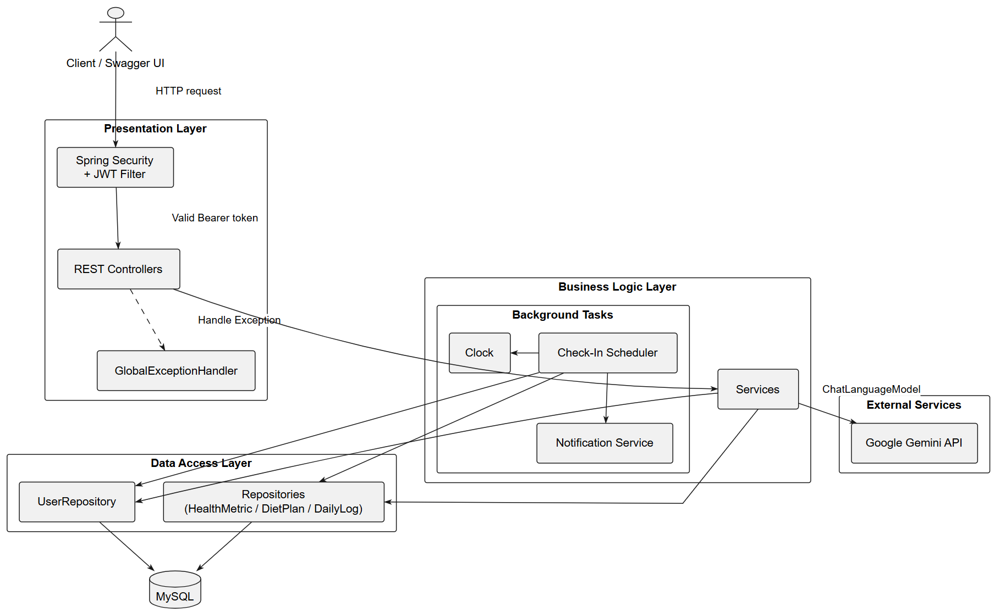

# Fitness & Nutrition Tracking API

Hệ thống backend theo dõi chỉ số sức khỏe, tính toán nhu cầu dinh dưỡng và tạo thực đơn cá nhân hóa bằng AI dựa trên mục tiêu thể hình của người dùng.

## 1. Giới thiệu

Fitness & Nutrition Tracking API cung cấp nền tảng theo dõi sức khỏe và dinh dưỡng, trong đó:

- Người dùng có thể đăng ký, đăng nhập và xác thực bằng JWT.
- Hệ thống tự động tính BMI, BMR và TDEE từ chiều cao, cân nặng, tuổi, giới tính và mức vận động.
- Người dùng có thể tạo thực đơn 7 ngày bằng AI (Google Gemini) theo mục tiêu giảm cân, duy trì hoặc tăng cơ.
- Người dùng check-in lượng calo nạp vào và cân nặng hằng ngày, xem lại lịch sử gần đây.
- Một tiến trình nền tự động nhắc nhở người dùng chưa check-in vào 20:00 mỗi ngày.
- Tài liệu API được công bố qua OpenAPI/Swagger UI, có thể xem trực tuyến qua GitHub Pages.

## 2. Chức năng chính

- Đăng ký, đăng nhập và xác thực người dùng bằng JWT.
- Phân quyền request theo token; các API nghiệp vụ yêu cầu Bearer token.
- Quản lý thông tin người dùng.
- Tính toán và lưu chỉ số sức khỏe: BMI, BMR, TDEE.
- Tạo thực đơn 7 ngày bằng AI và lưu lại theo từng người dùng.
- Xem thực đơn mới nhất của người dùng.
- Check-in dinh dưỡng hằng ngày và xem lịch sử check-in.
- Scheduler tự động gửi nhắc nhở cho người dùng chưa check-in.
- Kiểm thử đơn vị cho các service và scheduler.
- Bộ kiểm thử API bằng Postman cho tất cả endpoint (bao gồm trường hợp lỗi và xác thực).
- Tài liệu API tự động bằng Springdoc OpenAPI và Swagger UI.

## 3. Công nghệ sử dụng

### Backend

- Java 17
- Spring Boot 3.4.1
- Spring Web
- Spring Data JPA
- Spring Security
- JWT (jjwt 0.12.5)
- Bean Validation
- Lombok
- Springdoc OpenAPI (Swagger UI)

### AI

- LangChain4j 0.36.2
- Google Gemini (`gemini-1.5-flash`)

### Hạ tầng và công cụ

- MySQL 8
- Docker Compose
- phpMyAdmin
- Maven Wrapper
- JUnit 5 và Mockito
- Postman (kiểm thử API)

### Frontend

- Không có frontend trong repository này; dự án cung cấp REST API.

## 4. Kiến trúc hệ thống

Hệ thống là một ứng dụng Spring Boot dạng monolith phân tầng. Request đi qua JWT filter, vào controller, xuống service, rồi tới repository và MySQL. Riêng tính năng tạo thực đơn, service gọi Google Gemini để sinh JSON thực đơn 7 ngày.



### Cấu trúc package

| Package | Chức năng |
|---|---|
| `config` | Cấu hình Spring Security, JWT, OpenAPI, LangChain4j |
| `controller` | REST Controllers cho auth, health metrics, diet plans, daily logs |
| `dto` | Request/Response và enum (`ActivityLevel`, `FitnessGoal`) |
| `entity` | Thực thể JPA: `User`, `HealthMetric`, `DietPlan`, `DailyLog` |
| `repository` | Spring Data JPA repositories |
| `security` | JWT filter và token provider |
| `service` | Xử lý nghiệp vụ và tích hợp AI |
| `scheduler` | Tiến trình nhắc nhở check-in hằng ngày |
| `exception` | Xử lý lỗi toàn cục |

### Mô hình dữ liệu

| Bảng | Quan hệ | Mô tả |
|---|---|---|
| `users` | 1:1 `health_metrics`, 1:N `diet_plans`, 1:N `daily_logs` | Thông tin tài khoản |
| `health_metrics` | thuộc 1 `user` | Chiều cao, cân nặng, BMI, BMR, TDEE |
| `diet_plans` | thuộc 1 `user` | Mục tiêu và thực đơn 7 ngày (JSON) |
| `daily_logs` | thuộc 1 `user` | Calo nạp vào và cân nặng theo ngày |

## 5. Hướng dẫn cài đặt và chạy

### Yêu cầu

- Java 17
- Docker Desktop (tùy chọn, để chạy MySQL và ứng dụng bằng container)
- Git

### Cấu hình

Các giá trị nhạy cảm được tách khỏi code và nạp từ file `.env` (đã nằm trong `.gitignore`):

1. Sao chép file mẫu:

   ```bash
   copy .env.example .env      # Windows
   cp .env.example .env        # macOS/Linux
   ```

2. Điền giá trị vào `.env` (để trống nếu chưa có key):

   ```properties
   DB_URL=jdbc:mysql://localhost:3306/fitness_db?useSSL=false&serverTimezone=UTC&allowPublicKeyRetrieval=true
   DB_USERNAME=root
   DB_PASSWORD=your_password
   MYSQL_ROOT_PASSWORD=your_password
   GEMINI_API_KEY=your_gemini_api_key
   GEMINI_MODEL=gemini-1.5-flash
   JWT_SECRET=your_jwt_secret
   JWT_EXPIRATION=86400000
   ```

3. Nếu chưa có `application.properties`, sao chép từ file mẫu:

   ```bash
   copy src\main\resources\application.properties.example src\main\resources\application.properties
   ```

`application.properties` đọc các biến từ `.env` qua dòng `spring.config.import=optional:file:.env[.properties]`. Khi chạy bằng Docker Compose, các biến trong `.env` được truyền vào container qua `docker-compose.yml`.

> Không commit `.env` hoặc `application.properties`. Chỉ commit các file `.example`.

### Khởi chạy hạ tầng

Chỉ khởi chạy hạ tầng (MySQL và phpMyAdmin) để chạy backend trực tiếp bằng Maven:

```bash
docker compose up -d fitness-db fitness-phpmyadmin
```

Hoặc khởi chạy toàn bộ hệ thống bằng Docker (cần build JAR trước, xem mục "Chạy bằng Docker"):

```bash
docker compose up -d --build
```

Database được khởi tạo từ [`src/main/resources/init-db.sql`](src/main/resources/init-db.sql).

Các địa chỉ truy cập:

| Thành phần | Địa chỉ |
|---|---|
| Backend API | http://localhost:8081 |
| phpMyAdmin | http://localhost:8085 |
| MySQL | `localhost:3306` |

Thông tin mặc định trong `docker-compose.yml`:

```text
MySQL database: fitness_db
MySQL username: root
MySQL password: 123
```

### Chạy backend trực tiếp bằng Maven

Trên Windows:

```bash
mvnw.cmd spring-boot:run
```

Trên macOS/Linux:

```bash
./mvnw spring-boot:run
```

Ứng dụng chạy tại:

```text
http://localhost:8081
```

### Chạy bằng Docker

Dockerfile sử dụng file JAR đã build sẵn, nên cần build trước:

```bash
mvnw.cmd clean package
docker compose up -d --build
```

### Chạy kiểm thử

```bash
mvnw.cmd test
```

### Kiểm thử API bằng Postman

Bộ collection nằm tại [`postman/Fitness_Nutrition.postman_collection.json`](postman/Fitness_Nutrition.postman_collection.json), gồm 4 folder: `Auth`, `Health Metrics`, `Diet Plans`, `Daily Logs`.

1. Mở Postman, chọn **Import** và trỏ tới file collection trên.
2. Đảm bảo backend đang chạy tại `http://localhost:8081` (biến `base_url` trong collection).
3. Chạy toàn bộ collection (Runner) hoặc từng request/folder tùy ý.

Collection tự động đăng nhập trước các request cần xác thực: nếu tài khoản kiểm thử chưa tồn tại, collection tự đăng ký rồi lấy token và lưu vào biến `bearer_token`. Vì vậy không cần chạy `Login` thủ công hay copy token.

Thông tin tài khoản kiểm thử (giá trị giả, chỉ dùng cho môi trường local):

```text
username: test_user
password: Test@12345
email:    test_user@example.com
```

> Mật khẩu trên là tài khoản test cục bộ, không phải thông tin thật nên không cần ẩn. Nếu muốn tách khỏi collection, có thể chuyển `test_username`, `test_password`, `test_email` sang Postman Environment và không commit file environment đó.

> Folder `Diet Plans` cần `GEMINI_API_KEY` hợp lệ trong `.env` để tạo thực đơn; nếu chưa có key, test của endpoint này chấp nhận phản hồi `400` (AI chưa cấu hình) thay vì `200`.

### Tài liệu API

- **Tài liệu tương tác trực tuyến (không cần chạy server):**
  https://trungkien-tikey.github.io/Fitness-Nutrition_Tracking/
- **OpenAPI specification:** [`docs/openapi.yaml`](docs/openapi.yaml)
- **Swagger UI khi backend đang chạy:** http://localhost:8081/swagger-ui.html
- **OpenAPI JSON khi backend đang chạy:** http://localhost:8081/v3/api-docs

> Trang GitHub Pages được phục vụ từ thư mục `docs/` và nạp `openapi.yaml` vào Swagger UI. Nút "Try it out" chỉ gọi được API khi backend đang chạy.

### Danh sách API

| Method | Endpoint | Xác thực | Chức năng |
|---|---|---|---|
| `POST` | `/api/auth/register` | Không | Đăng ký tài khoản |
| `POST` | `/api/auth/login` | Không | Đăng nhập, nhận JWT |
| `POST` | `/api/health-metrics/calculate` | Bearer | Tính BMI, BMR, TDEE |
| `POST` | `/api/diet-plans/generate` | Bearer | Tạo thực đơn 7 ngày bằng AI |
| `GET` | `/api/diet-plans/latest` | Bearer | Lấy thực đơn mới nhất |
| `POST` | `/api/daily-logs/check-in` | Bearer | Check-in dinh dưỡng hằng ngày |
| `GET` | `/api/daily-logs/history?days=7` | Bearer | Xem lịch sử check-in |

## 6. Kết quả, hạn chế và hướng phát triển

### Kết quả đạt được

- Xây dựng backend Spring Boot với đầy đủ luồng đăng ký, đăng nhập và xác thực JWT.
- Hoàn thành chức năng tính toán và lưu chỉ số BMI, BMR, TDEE.
- Tích hợp Google Gemini để sinh thực đơn 7 ngày dạng JSON.
- Hoàn thành chức năng check-in dinh dưỡng và xem lịch sử.
- Tích hợp scheduler nhắc nhở người dùng chưa check-in lúc 20:00.
- Có unit test cho các service và scheduler bằng JUnit 5 và Mockito.
- Có xử lý lỗi toàn cục và validate dữ liệu đầu vào.
- Có tài liệu OpenAPI/Swagger UI, công bố trực tuyến qua GitHub Pages.
- Đóng gói được ứng dụng bằng Docker và Docker Compose.

### Hạn chế hiện tại

- Ứng dụng vẫn là monolith, chưa tách thành microservices.
- Chưa có frontend; người dùng cần dùng Swagger UI hoặc client riêng.
- Chức năng AI phụ thuộc vào API key và dịch vụ Google Gemini bên ngoài.
- Chưa có refresh token và phân quyền theo vai trò.
- Dockerfile cần file JAR build sẵn, chưa build đa tầng (multi-stage build).
- Chưa có quy trình CI/CD hoàn chỉnh.

### Hướng phát triển trong tương lai

- Bổ sung frontend để người dùng thao tác trực quan.
- Phân quyền theo vai trò (người dùng, huấn luyện viên, quản trị viên).
- Thêm refresh token và thu hồi token.
- Chuyển cấu hình sang biến môi trường/secret manager.
- Tăng độ phủ unit test và bổ sung integration test.
- Xây dựng CI/CD bằng GitHub Actions.
- Dùng multi-stage build cho Docker image.
- Bổ sung phân trang, cache và giới hạn tần suất request.
- Hoàn thiện phân tích tiến độ và gợi ý dinh dưỡng bằng AI.
